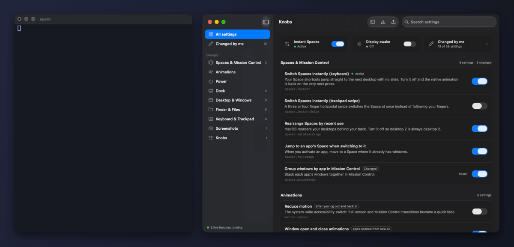

<h1 align="center">Knobs</h1>

<p align="center">
  <b>A macOS settings layer your coding agent can trust.</b><br>
  112 settings, each with a plain description, the macOS default and an honest note on when it takes effect. Every write is read back, and one command undoes a profile.
</p>

<p align="center">
  <a href="README.zh-CN.md">简体中文</a> ·
  <a href="#install">Install</a> ·
  <a href="#what-it-controls">Settings</a> ·
  <a href="#let-an-agent-drive">Agents</a> ·
  <a href="#move-to-a-new-mac">New Mac</a>
</p>

<p align="center">
  
</p>
<p align="center"><sub>One sentence to Claude Code (Haiku), with no hint about Knobs: it finds the skill, changes two settings live and exports the setup. Real run; thinking time is shortened and the account name in paths is masked. Knobs was built with the help of AI coding agents.</sub></p>

Knobs is a `knobs` command plus a small menu bar app and settings window. It collects the tweaks people usually paste from dotfiles (`defaults write …`) and gives each one an id, an explanation, its accepted values, and a note on when it takes effect.

## Why

An agent can already run `defaults write` on its own. The trouble is what happens next: the key it remembers may be years out of date, it cannot tell whether macOS accepted the value, it does not know whether the Dock needs a restart or the user needs to log out, and there is no undo. Knobs is the layer that answers those four questions.

- **Typed catalog, also over MCP.** `knobs list --json` gives every setting's id, meaning, accepted values, current value, macOS default and when it takes effect. `knobs mcp` offers the same to MCP clients, read-only unless you allow writes.
- **Checked writes.** `knobs set` rejects values outside the accepted range, reads the value back after writing, and exits 1 with the reason on stderr when macOS did not take it. It restarts the Dock or Finder only when a value actually changed.
- **Undo.** Every change (`set`, `reset`, `apply`, or a click in the window) saves a snapshot first, and `knobs undo` steps back one change, including handing untouched settings back to macOS.
- **Readable and portable.** 112 settings in 13 groups, each with the exact preference key behind it. `knobs export` writes one JSON file you can apply on another Mac, from a file, a link or a preset.

Also included, as conveniences rather than the reason to use Knobs:

- **Instant Space switching comes from [InstantSpaceSwitcher](https://github.com/jurplel/InstantSpaceSwitcher)** by jurplel (MIT). Its code is vendored in `Vendor/ISS`; Knobs only puts the switch next to your other settings and in your profile. If instant switching is all you want, install InstantSpaceSwitcher itself: it has a Homebrew cask and a prebuilt download.
- **Keep the display awake**, using the same power assertion as the built-in `caffeinate`.

## How it compares

| | [TinkerTool](https://www.bresink.com/osx/TinkerTool.html) | [PowerChest](https://github.com/scripsweave/PowerChest) | [nix-darwin](https://github.com/nix-darwin/nix-darwin) | Knobs |
|---|---|---|---|---|
| What it is | free GUI for hidden settings | open-source GUI for hidden settings | declarative config for the whole Mac | settings catalog with a CLI for agents, plus a GUI |
| Number of settings | more than Knobs | 80+ (README) | Dock, Finder, global defaults and much more | 112 |
| An agent can list, validate and change settings | no | no | by editing Nix files | `knobs list --json`, `knobs set`, exit codes |
| Says when each change takes effect | for some settings | restarts the Dock or Finder when needed | after a rebuild | every setting: now, apps opened later, or after logout |
| Undo | restore the original state | snapshot before every change | roll back a generation | snapshot before every change; `knobs undo` steps back one at a time |
| Share a setup | no | export and import a profile | share the flake | one JSON file, a link or a preset |
| Install | signed download | DMG download | Nix | build from source with the Command Line Tools; no signed download yet |

Where Knobs is worse: fewer settings than TinkerTool, no signed download or Homebrew cask yet, and PowerChest and [Mainspring](https://trymainspring.com) are more polished apps for people who never open a terminal. Knobs is not a replacement for a full dotfiles or Nix setup.

**Why not just `defaults write`, nix-darwin, TinkerTool or PowerChest?** Use them if they fit. `defaults write` from memory is what Knobs is meant to replace for agents; nix-darwin manages far more but needs Nix and a rebuild; TinkerTool and PowerChest are good GUIs with no interface an agent can call. Knobs is for when you want an agent to change your Mac's settings and still know what it changed, whether it worked, and how to undo it.

## Install

Requires macOS 13 or later and the Swift compiler (`xcode-select --install` if you have never installed it).

```bash
git clone https://github.com/JJ22007/knobs.git
cd knobs
bash build.sh install
```

This builds the app, runs the self-test, installs `Knobs.app` into `~/Applications`, links the `knobs` command into `~/.local/bin`, and opens the window.

### The one permission

Only instant Space switching needs a permission: **Accessibility**, because Knobs has to catch your Space shortcut before macOS starts its animation. Switch Knobs on under System Settings → Privacy & Security → Accessibility. It starts working the moment you do. Everything else works with no permission and no password.

If you plan to rebuild from source, run this once so the grant survives rebuilds:

```bash
bash scripts/setup-signing.sh
```

## What it controls

| Group | Examples |
|---|---|
| Spaces & Mission Control | instant switching (keyboard and trackpad), stop auto-rearranging, group windows by app |
| Animations | window open/close, resize speed, Quick Look, Finder, Dock bounce, minimize effect, Reduce Motion |
| Power | keep the display awake, keep the Mac awake |
| Menu Bar & Clock | auto-hide the menu bar, icon spacing (fit more icons beside the notch), seconds, weekday, date, 24-hour time |
| Dock | auto-hide, hide delay and speed, size, position, recents, indicators, only open apps, scroll to show windows |
| Hot Corners | what each screen corner does: Mission Control, desktop, lock screen, Quick Note, nothing |
| Desktop & Windows | desktop icons, click wallpaper to reveal, Stage Manager, widgets, edge tiling, tile margins, ⌃⌘-drag windows from anywhere, title bar double-click, tabs |
| Finder & Files | extensions, hidden files, path bar, status bar, default view, search scope, `.DS_Store`, save dialogs, empty Trash after 30 days, external disks on the desktop |
| Keyboard & Typing | key repeat, press-and-hold, Tab through all controls, autocorrect, smart quotes and dashes, inline prediction |
| Trackpad & Mouse | tap to click, click pressure, quiet clicks, three-finger drag, scroll inertia, natural scrolling, two-finger right click, look up, swipe between pages, tracking and scroll speed, double-click speed |
| Screenshots | format, location, shadow, thumbnail, date in the file name |
| System & Apps | scroll bars, sidebar icon size, reopen windows, interface sounds, volume feedback, stop Photos and Time Machine popping up for new devices |

Animations also covers Mission Control speed. Run `knobs list` for the full list with current values.

Each setting says when it takes effect:

- **instant**: right away. Knobs restarts the Dock or Finder for you when that is what it takes.
- **apps opened from now on**: running apps keep the old behaviour until you reopen them.
- **after you log out and back in**: macOS only reads these at login.

## Let an agent drive

If you use Claude Code, `build.sh install` asks whether to add a [Claude Code skill](https://docs.claude.com/en/docs/claude-code/skills) at `~/.claude/skills/knobs`, so Claude Code knows about Knobs in every folder: ask "stop my screen from sleeping" anywhere and it reaches for `knobs` on its own. Nothing is written there without a yes (or `KNOBS_SKILL=1`); an existing Knobs skill is kept up to date. `knobs skill install` adds it later, `knobs skill remove` takes it out, and `knobs skill` prints it for other agents. Other agents can read [AGENTS.md](AGENTS.md).

```bash
knobs list --json              # every setting: id, meaning, accepted values, current value, when it applies
knobs describe dock.autohide   # one setting in detail
knobs set dock.autohide on dock.autohideDelay 0
knobs reset dock.autohideDelay # hand it back to the macOS default
knobs set spaces.instant on    # reports whether it is really active, and why not if it is not
knobs set dock.size 48 --dry-run --json   # preview; --json gives before, after, verified, takesEffect
knobs undo                     # step back one change; knobs undo --list shows the history
knobs verify                   # read-only: do the keys written on this Mac match the catalog?
knobs status
```

Every change, whether it comes from `knobs`, an agent or a click in the window, saves a snapshot first, so `knobs undo` (or Undo in the window, ⌘Z) steps back one change at a time. A batch is all or nothing: if one value is refused, nothing is written.

For MCP clients (Claude Desktop, Cursor and others), `knobs mcp` is a stdio MCP server with the same tools. It is read-only unless you start it as `knobs mcp --allow-write`:

```json
{ "mcpServers": { "knobs": { "command": "~/.local/bin/knobs", "args": ["mcp", "--allow-write"] } } }
```

Some clients do not expand `~`; use the full path to `knobs` there.

Tell your agent something like:

> Use the `knobs` command to look at my macOS settings (`knobs list --json`). I want everything to feel faster: no animations I don't need, and Spaces that switch instantly. Explain each change before you make it.

The "Agent prompt" button in the window copies a ready-made version. The exit code is 0 when everything applied and 1 when something was refused, with the reason on stderr (or in `errors` with `--json`), so an agent can tell.

## Move to a new Mac

On the old Mac:

```bash
knobs export ~/Desktop/my-mac.knobs.json
```

The file holds every setting you changed, your Space shortcuts, and the config files of known companion tools. Today that list has one entry, `~/.config/paneful/config.json` for [Paneful](https://github.com/JJ22007/paneful), the author's own window tool; it is only exported when the file exists, and the list lives in `Profile.companionFiles` in `Sources/Engine.swift`. It also carries its own instructions, so on the new Mac you can give it to any coding agent and say:

> Set up this Mac from `my-mac.knobs.json`.

Or do it by hand:

```bash
git clone https://github.com/JJ22007/knobs.git && cd knobs && bash build.sh install
knobs apply ~/Desktop/my-mac.knobs.json --dry-run   # see what would change
knobs apply ~/Desktop/my-mac.knobs.json
```

## Share your setup

A profile is a small, readable JSON file, so a setup travels like a dotfile: put it in a gist or a repo and anyone can apply it from the link.

```bash
knobs export my-mac.knobs.json                                  # then publish it as a gist, or commit it
knobs apply https://gist.githubusercontent.com/you/…/raw/my-mac.knobs.json --dry-run
knobs apply https://gist.githubusercontent.com/you/…/raw/my-mac.knobs.json
```

A brand-new Mac needs one line. It installs Knobs, shows what the profile changes, then applies it:

```bash
curl -fsSL https://raw.githubusercontent.com/JJ22007/knobs/main/scripts/bootstrap.sh | bash -s -- <preset, link or file>
```

Ready-made presets ship with the app (`knobs presets`), and pull requests with new ones are welcome in [`presets/`](presets). [`examples/`](examples) holds the author's own profile as a real-world example; it is not bundled.

| Preset | For |
|---|---|
| `snappy` | no waiting on animations, a quiet Dock, a Finder that shows what is there |
| `developer` | fast key repeat, no autocorrect or smart punctuation, every file and path visible |
| `focus` | fewer things asking for attention, a clean desktop, no pop-ups when you plug things in |
| `presenter` | demos and screen sharing: display stays on, clean desktop, quiet corners |

Only settings in the catalog and the companion files listed in `Engine.swift` can be written by a profile, and `--dry-run` always shows the full list first. Read a stranger's profile before applying it, the same as any dotfile.

Every `knobs apply` (and Import in the window) first saves a snapshot to `~/.config/knobs/backups`. `knobs undo` puts every setting back the way it was, including handing untouched ones back to macOS; `knobs undo --list` shows the snapshots.

## Shortcuts

Instant switching replaces these keys while it is on. They default to the macOS ones.

```bash
knobs shortcut                      # show
knobs shortcut spaceLeft ctrl+left
knobs shortcut space1 ctrl+1        # jump straight to desktop 1 … space9
knobs shortcut space1 none
```

## How it works

- Preference settings are written the same way `defaults write` does, then read back to confirm macOS accepted them.
- Instant switching posts a synthetic high-velocity trackpad swipe, which makes the Dock finish the transition at once. This is the technique from [InstantSpaceSwitcher](https://github.com/jurplel/InstantSpaceSwitcher) by jurplel (MIT), vendored in `Vendor/ISS`.
- Keep-awake holds a power assertion, the same mechanism as `caffeinate`.
- Live features need the app running. Turn on "Open Knobs at login" so they come back after a restart.

Files: `~/.config/knobs/config.json` (live features and shortcuts), `~/.config/knobs/status.json` (what is active right now).

## Add your own setting

One entry in `Sources/Catalog.swift` and the window, the command, export and import all pick it up. `AGENTS.md` has the details, written so a coding agent can do it for you.

## License

MIT. Includes InstantSpaceSwitcher's gesture code, also MIT. Icons are from [Lucide](https://github.com/lucide-icons/lucide) (ISC), bundled as SVG in `Resources/icons`.
