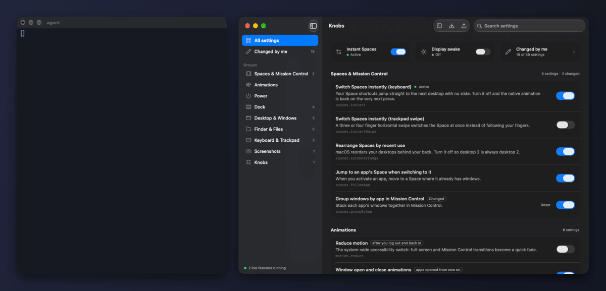

<h1 align="center">Knobs</h1>

<p align="center">
  <b>让 AI agent 改 Mac 设置时不再瞎猜。</b><br>
  112 项常用设置,每项写明含义、macOS 默认值和什么时候生效;写完回读确认,一条命令撤销整套配置。
</p>

<p align="center"><a href="README.md">English</a></p>

<p align="center">
  
</p>
<p align="center"><sub>对 Claude Code(Haiku)说一句话,完全不提 Knobs:它自己找到 skill,实时改了两项设置并导出配置。真实运行,思考时间被缩短,路径里的账户名做了遮挡。Knobs 的开发过程用了 AI 编程 agent。</sub></p>

Knobs 是一个 `knobs` 命令,外加一个菜单栏小应用和设置窗口。它把大家常从 dotfiles 里复制的那些调整(`defaults write …`)收到一起,给每一项起了 id、写了说明、列出合法取值,并标注它什么时候生效。

## 为什么做这个

agent 自己就会跑 `defaults write`。问题出在之后:它记得的键可能早就失效了;写进去 macOS 接没接受,它不知道;要不要重启程序坞、要不要注销,它也不知道;改错了没法撤销。Knobs 就是回答这四个问题的那一层。

- **带类型的设置目录,也能通过 MCP 用。** `knobs list --json` 给出每一项的 id、含义、合法取值、当前值、macOS 默认值和生效时机。`knobs mcp` 把同样的内容提供给 MCP 客户端,默认只读,允许后才能修改。
- **写入有校验。** `knobs set` 拒绝不合法的值,写完回读;macOS 没接受就以退出码 1 结束,原因写在 stderr。只有值真的变了才重启程序坞或访达。
- **能撤销。** 每次修改(`set`、`reset`、`apply`,或在窗口里点一下)之前都先存快照,`knobs undo` 一次撤回一步,原本没改过的也会交还给 macOS。
- **看得懂,带得走。** 112 项设置,分成 13 组,每一项都有背后真实的偏好设置键。`knobs export` 导出一个 JSON 文件,可以从文件、链接或预设套用到另一台 Mac。

顺带包含的功能(只是方便,不是选 Knobs 的理由):

- **无动画切换桌面来自 jurplel 的 [InstantSpaceSwitcher](https://github.com/jurplel/InstantSpaceSwitcher)(MIT 许可)。** 代码放在 `Vendor/ISS`,Knobs 只是把这个开关和其他设置放在一起、写进配置文件。如果你只想要无动画切换,请直接装 InstantSpaceSwitcher:它有 Homebrew cask 和预编译安装包。
- **屏幕常亮**,用的是和系统自带 `caffeinate` 相同的电源断言。

## 和其他做法比

| | [TinkerTool](https://www.bresink.com/osx/TinkerTool.html) | [PowerChest](https://github.com/scripsweave/PowerChest) | [nix-darwin](https://github.com/nix-darwin/nix-darwin) | Knobs |
|---|---|---|---|---|
| 是什么 | 免费的隐藏设置图形工具 | 开源的隐藏设置图形工具 | 声明式管理整台 Mac | 带命令行的设置目录,给 agent 用,也有图形界面 |
| 设置数量 | 比 Knobs 多 | 80+(README) | 程序坞、访达、全局设置,以及多得多的东西 | 112 |
| agent 能列出、校验、修改设置 | 不能 | 不能 | 要改 Nix 文件 | `knobs list --json`、`knobs set`、退出码 |
| 标注每项什么时候生效 | 部分设置有 | 需要时自动重启程序坞或访达 | 重新构建后 | 每一项都标:立即、之后打开的 App、注销后 |
| 撤销 | 恢复到原始状态 | 每次修改前存快照 | 回滚到上一代 | 每次修改前存快照,`knobs undo` 一步步撤回 |
| 分享一套设置 | 不支持 | 导出导入配置文件 | 分享 flake | 一个 JSON 文件、一个链接或一个预设 |
| 安装 | 签名安装包 | DMG 下载 | Nix | 用 Command Line Tools 从源码编译,还没有签名安装包 |

Knobs 更差的地方:设置比 TinkerTool 少,还没有签名安装包和 Homebrew cask,PowerChest 和 [Mainspring](https://trymainspring.com) 对完全不用终端的人来说更完整好用。Knobs 也不是要取代完整的 dotfiles 或 Nix 配置。

**为什么不直接用 `defaults write`、nix-darwin、TinkerTool 或 PowerChest?** 合适就用它们。Knobs 要替代的,正是 agent 凭记忆写 `defaults write`;nix-darwin 管得多得多,但要学 Nix、要重新构建;TinkerTool 和 PowerChest 是好用的图形工具,但没有 agent 能调用的接口。当你想让 agent 改 Mac 设置,同时清楚它改了什么、改成没有、怎么撤回,就用 Knobs。

## 安装

需要 macOS 13 或更高版本,以及 Swift 编译器(没装过就先运行 `xcode-select --install`)。

```bash
git clone https://github.com/JJ22007/knobs.git
cd knobs
bash build.sh install
```

脚本会编译、自测、把 `Knobs.app` 装到 `~/Applications`,把 `knobs` 命令链接到 `~/.local/bin`,然后打开窗口。

### 唯一需要的权限

只有"无动画切换桌面"需要权限:**辅助功能**。因为 Knobs 必须在系统开始播放动画之前接住你的快捷键。在 系统设置 → 隐私与安全性 → 辅助功能 里打开 Knobs 即可,打开的瞬间就生效。其他所有功能都不需要权限,也不需要密码。

如果你会反复从源码编译,先运行一次下面的脚本,授权就不会因为重新编译而失效:

```bash
bash scripts/setup-signing.sh
```

## 它能管什么

| 分组 | 举例 |
|---|---|
| 桌面空间与调度中心 | 无动画切换(键盘和触控板)、不再自动重排空间、按 App 分组窗口 |
| 动画 | 窗口开关、缩放速度、快速查看、访达、程序坞弹跳、最小化效果、减弱动态效果 |
| 电源与亮屏 | 屏幕常亮、电脑不休眠 |
| 菜单栏与时钟 | 自动隐藏菜单栏、图标间距(刘海旁能放下更多图标)、秒、星期、日期、24 小时制 |
| 程序坞 | 自动隐藏、延迟与速度、大小、位置、最近使用、指示点、只显示已打开的 App、滚动显示窗口 |
| 触发角 | 屏幕四个角各做什么:调度中心、桌面、锁屏、快速备忘录或不执行 |
| 桌面与窗口 | 桌面图标、点按墙纸显示桌面、台前调度、小组件、贴边平铺、平铺边距、⌃⌘ 任意位置拖窗口、双击标题栏、标签页 |
| 访达与文件 | 扩展名、隐藏文件、路径栏、状态栏、默认视图、搜索范围、`.DS_Store`、保存对话框、30 天后清倒废纸篓、桌面显示外置磁盘 |
| 键盘与输入 | 按键重复、长按重音菜单、Tab 切换所有控件、自动纠正、智能引号与破折号、行内预测 |
| 触控板与鼠标 | 轻点点按、点按力度、安静点按、三指拖移、滚动惯性、自然滚动、双指右键、三指查询、页面间轻扫、跟踪与滚动速度、连按速度 |
| 截图 | 格式、保存位置、阴影、缩略图、文件名带日期 |
| 系统与 App | 滚动条、边栏图标大小、恢复窗口、界面音效、音量反馈音、插入新设备时不弹“照片”和时间机器 |

动画分组里还有调度中心速度。运行 `knobs list` 可以看到完整清单和当前值。

每一项都标明生效时机:

- **立即生效**:马上起作用。需要重启程序坞或访达时,Knobs 会替你做。
- **之后打开的 App 生效**:已经在运行的 App 要重新打开才会变。
- **注销重新登录后生效**:系统只在登录时读取这些设置。

## 让 agent 来操作

如果你用 Claude Code,`build.sh install` 会询问是否在 `~/.claude/skills/knobs` 装一个 [Claude Code skill](https://docs.claude.com/en/docs/claude-code/skills),这样 Claude Code 在任何文件夹都认识 Knobs:随便在哪儿说一句“别让我的屏幕熄灭”,它会自己用上 `knobs`。不回答“是”(或设置 `KNOBS_SKILL=1`)就不会往那里写任何东西;已经装过的 Knobs skill 会保持更新。之后可以用 `knobs skill install` 安装,`knobs skill remove` 移除;`knobs skill` 会把内容打印出来,方便交给其他 agent。其他 agent 可以读 [AGENTS.md](AGENTS.md)。

```bash
knobs list --json              # 每项设置:id、含义、可接受的值、当前值、何时生效
knobs describe dock.autohide   # 查看某一项的详细说明
knobs set dock.autohide on dock.autohideDelay 0
knobs reset dock.autohideDelay # 交还给 macOS 默认值
knobs set spaces.instant on    # 会报告是否真的生效,没生效会说明原因
knobs set dock.size 48 --dry-run --json   # 预览;--json 会给出修改前后的值、是否回读确认、何时生效
knobs undo                     # 撤回一步;--dry-run 先预览,--list 查看历史
knobs diff snappy              # 比较配置文件和这台 Mac,不写入(退出码 0 一致,1 不一致)
knobs verify                   # 只读:这台 Mac 上已写入的键是否符合目录
knobs status
```

不管是用 `knobs`、让 agent 改,还是在窗口里点一下,每次修改前都会先存快照,所以 `knobs undo`(或窗口里的“撤销”,⌘Z)可以一步一步往回撤。一批修改要么全做要么全不做:有一个值被拒绝,就什么都不写。

支持 MCP 的客户端(Claude Desktop、Cursor 等)可以用 `knobs mcp`,它是一个 stdio MCP server,工具和命令行一致。默认只读,用 `knobs mcp --allow-write` 启动才允许修改:

```json
{ "mcpServers": { "knobs": { "command": "~/.local/bin/knobs", "args": ["mcp", "--allow-write"] } } }
```

有些客户端不会展开 `~`,那里请写 `knobs` 的完整路径。

可以这样对 agent 说:

> 用 `knobs` 命令看一下我的 macOS 设置(`knobs list --json`)。我想让一切更快:去掉不必要的动画,桌面空间切换不带动画。每改一项之前先告诉我它是做什么的。

窗口里的"Agent 提示词"按钮可以直接复制一段现成的提示词。全部成功时退出码为 0;有任何一项被拒绝时为 1,原因写在 stderr(加 `--json` 时在 `errors` 里),agent 能据此判断。

## 场景:设置和其他工具一起切换

场景就是一个配置文件,只是它还能通过其他工具自己的 agent 接口去控制它们。目前支持作者的另外两个工具:[Overbright](https://github.com/JJ22007/overbright) 设置内建屏幕的亮度,并读回屏幕的实际亮度证明真的生效;[Paneful](https://github.com/JJ22007/paneful) 摆放窗口,并读回每个窗口的实际位置。

```bash
knobs scene                      # 列出场景
knobs scene present --dry-run    # 预览会改什么,亮度也在内
knobs scene present              # 切换
knobs undo                       # 全部还原,亮度也会还原
```

`present`(演示模式)会让屏幕不熄灭、隐藏桌面图标和小组件、自动隐藏程序坞、关掉触发角,并用 Overbright 把屏幕提亮到 130%。整个切换只存一份快照,所以一次 `knobs undo` 就能把设置和亮度一起还原。没装 Overbright 时会跳过亮度并在结果里说明。[`examples/present-keynote.knobs.json`](examples/present-keynote.knobs.json) 多了窗口布局:由 Paneful 让 Keynote 窗口铺满屏幕,同一次 `knobs undo` 会把所有窗口放回原处。勿扰模式不在其中:专注模式没有 Knobs 能写入并回读确认的设置。

想在自己的配置里加上亮度,写 `"overbright": { "percent": 130 }`(0–100 是背光,100 以上是增亮)。Knobs 调用的是 `overbright mcp`,不会去改 Overbright 的文件。想摆放窗口,写 `"paneful": { "layout": [{ "app": "Keynote", "x": 0, "y": 0, "w": 1, "h": 1 }] }`(位置是从左上角算起的屏幕比例;每个窗口要写 `app` 或 `title` 来挑窗口,`display` 选屏幕)。Knobs 调用 `paneful mcp`,报告每个窗口的回读结果;存下的窗口布局只留在这台 Mac 的快照里。

## 换新电脑

在旧电脑上:

```bash
knobs export ~/Desktop/my-mac.knobs.json
```

这个文件包含你改过的所有设置、切换空间的快捷键,以及已知配套工具的配置文件。目前清单里只有一项:`~/.config/paneful/config.json`,属于作者自己的分屏工具 [Paneful](https://github.com/JJ22007/paneful);只有这个文件存在时才会导出,清单写在 `Sources/Engine.swift` 的 `Profile.companionFiles` 里。文件里自带使用说明,所以在新电脑上把它交给任何一个编程 agent,说一句:

> 按照 `my-mac.knobs.json` 把这台 Mac 配置好。

也可以自己动手:

```bash
git clone https://github.com/JJ22007/knobs.git && cd knobs && bash build.sh install
knobs apply ~/Desktop/my-mac.knobs.json --dry-run   # 先看看会改什么
knobs apply ~/Desktop/my-mac.knobs.json
```

## 分享你的设置

配置文件是一个短小、看得懂的 JSON,所以设置可以像 dotfiles 一样传播:放进 gist 或仓库,别人用链接就能直接应用。

```bash
knobs export my-mac.knobs.json                                  # 然后发成 gist,或提交到仓库
knobs apply https://gist.githubusercontent.com/you/…/raw/my-mac.knobs.json --dry-run
knobs apply https://gist.githubusercontent.com/you/…/raw/my-mac.knobs.json
```

全新的 Mac 只要一行:装好 Knobs,先列出会改什么,再应用:

```bash
curl -fsSL https://raw.githubusercontent.com/JJ22007/knobs/main/scripts/bootstrap.sh | bash -s -- <预设名、链接或文件>
```

应用里自带几套现成预设(`knobs presets`),欢迎往 [`presets/`](presets) 提交你自己的。[`examples/`](examples) 里放着作者自己的配置,作为真实的例子,不会打包进应用。

| 预设 | 适合 |
|---|---|
| `snappy` | 不等动画、安静的程序坞、什么都看得见的访达 |
| `developer` | 按键重复快、不自动纠错不改标点、文件和路径全都看得见 |
| `focus` | 打扰更少、桌面干净、插设备不乱弹窗 |
| `presenter` | 演示和共享屏幕:屏幕不熄灭、桌面干净、角落安静 |

配置文件只能写入清单里的设置,以及 `Engine.swift` 里列出的配套文件;`--dry-run` 会先把要改的全部列出来。应用陌生人的配置前先读一遍,和对待别人的 dotfiles 一样。

每次 `knobs apply`(以及窗口里的"导入")都会先在 `~/.config/knobs/backups` 存一份快照。`knobs undo` 把所有设置恢复原样,原本没改过的也会交还给 macOS;`knobs undo --list` 列出所有快照。

## 快捷键

开启无动画切换后,由下面这些按键触发,默认与系统一致。

```bash
knobs shortcut                      # 查看
knobs shortcut spaceLeft ctrl+left
knobs shortcut space1 ctrl+1        # 直接跳到桌面 1,一直到 space9
knobs shortcut space1 none
```

## 原理

- 偏好设置类的项目,写入方式与 `defaults write` 相同,写完会读回来确认系统确实接受了。
- 无动画切换是合成一次速度极高的触控板横扫,让程序坞立刻完成切换。这个方法来自 jurplel 的 [InstantSpaceSwitcher](https://github.com/jurplel/InstantSpaceSwitcher)(MIT 许可),代码放在 `Vendor/ISS`。
- 屏幕常亮使用电源断言,与 `caffeinate` 是同一套机制。
- 这类实时功能需要 Knobs 在运行。打开"登录时打开 Knobs",重启后它们会自动恢复。

相关文件:`~/.config/knobs/config.json`(实时功能和快捷键)、`~/.config/knobs/status.json`(当前实际生效的状态)。

## 添加你自己的设置

在 `Sources/Catalog.swift` 里加一条,窗口、命令行、导出和导入就都有了。细节写在 `AGENTS.md` 里,可以直接让编程 agent 来加。

## 许可

MIT。其中包含 InstantSpaceSwitcher 的手势代码,同为 MIT。图标来自 [Lucide](https://github.com/lucide-icons/lucide)(ISC 许可),以 SVG 形式放在 `Resources/icons`。
